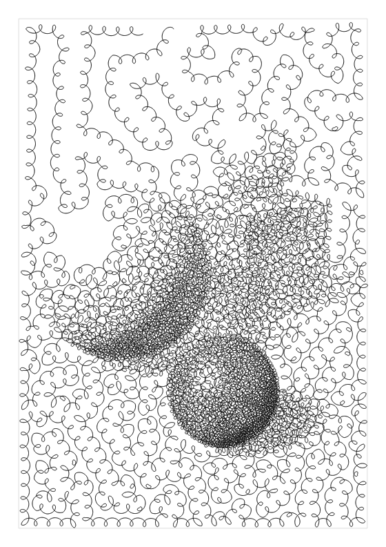
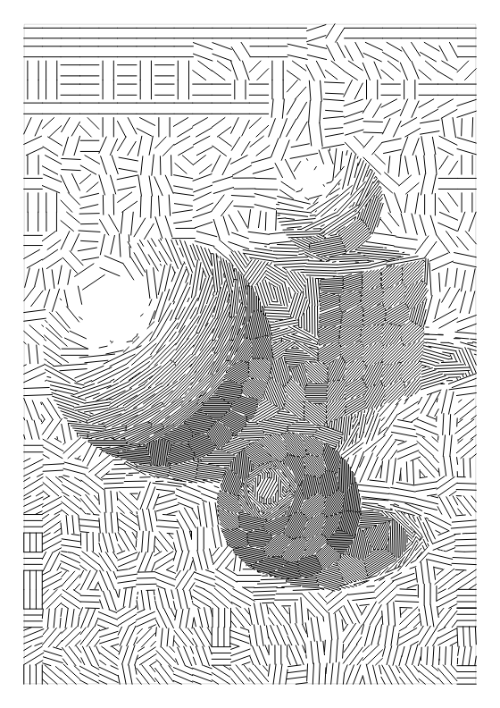
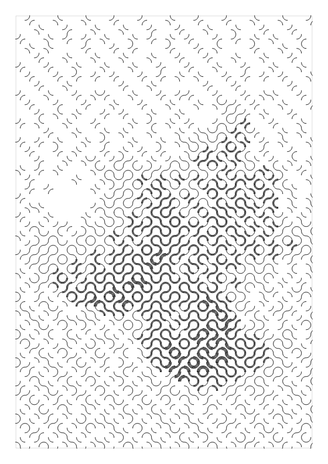

<p align="center">
  <picture>
    <source media="(prefers-color-scheme: dark)" srcset="docs/images/logo-dark.svg">
    
  </picture>
</p>

<p align="center"><strong>Turn images into drawings for pen plotters.</strong></p>

<p align="center">
  <a href="https://github.com/JonathanRJoyner/plotline/actions/workflows/ci.yml"></a>
  <a href="LICENSE"></a>
  
  
</p>

<p align="center">
  <a href="https://jonathanrjoyner.github.io/plotline/"><strong>Open it in your browser</strong></a>
  &nbsp;·&nbsp;
  <a href="#command-line">Command line</a>
  &nbsp;·&nbsp;
  <a href="docs/BRIEF.md">Design brief</a>
</p>

plotline converts raster images into vector line art, such as stippling, single continuous lines, dashes and sketched strokes. It comes with a live preview that shows the algorithm at work, so you can see what a setting does before you commit ink to paper.

<table>
  <tr>
    <td align="center" valign="top" width="33%"><br><sub><b>The image</b></sub></td>
    <td align="center" valign="top" width="33%"><br><sub><b>grid</b>: dots on a regular grid</sub></td>
    <td align="center" valign="top" width="33%"><br><sub><b>hatch</b>: crossing parallel lines</sub></td>
  </tr>
  <tr>
    <td align="center" valign="top"><br><sub><b>waves</b>: rippling lines, one stroke each</sub></td>
    <td align="center" valign="top"><br><sub><b>spiral</b>: one rippling spiral</sub></td>
    <td align="center" valign="top"><br><sub><b>ink</b>: dark areas as filled shapes, at threshold 0.3</sub></td>
  </tr>
  <tr>
    <td align="center" valign="top"><br><sub><b>scribble</b>: loops along one line</sub></td>
    <td align="center" valign="top"><br><sub><b>mosaic</b>: patches of parallel lines</sub></td>
    <td align="center" valign="top"><br><sub><b>truchet</b>: nested arcs on tiles in random turns</sub></td>
  </tr>
</table>

<p align="center"><sub>plotline drew every picture above with a 0.3 mm pen, from images it renders in code.</sub></p>

## Features

- **Twenty-one styles,** from dots on a grid to one continuous spiral. The table below describes each one, and the [style guide](docs/styles.md) shows each on the same picture with its settings and pen tips.
- **Live preview.** The browser GUI shows the drawing being built. It runs the engine inside the page as WebAssembly, so your image is never uploaded.
- **Suggestions.** The engine measures a new image and suggests changes: line art, levels, uneven paper, invert, noise, page orientation and colour, for which it picks two to four ink pens that draw the image's colours best. You apply each one with a click. The tone stage's Levels can also be Auto, which sets black and white from the image.
- **Plot lint.** After every run the engine checks the drawing for trouble on paper: marks drawn over each other, specks, lines closer than the pen, a drawing too light for the image's darks, heavy pen lifting or travel, and marks off the page or the machine. Where a setting fixes one, it says which.
- **Budgets.** Give a plot time, a path count, metres of pen-down line or a dot count, and plotline finds the value of the style's density setting, such as its line spacing, that meets it in up to eight runs.
- **Tone match.** Every run scores how closely the drawing's tones follow the image, seen from a metre or two, as a tone error and an SSIM. Optimize searches the style's density setting for the value that brings them closest, within a budget if you give one, and suggests it; nothing changes until you apply it. The tone stage's Response can also be Auto, which measures how much paper the style covers at each grey on a small test wedge and corrects the image for it.
- **Short pen travel.** Every run orders its paths to keep the pen's travel short, and the line styles lift the pen far less often than `grid`.
- **Plotter-ready output.** An SVG in millimetres holds one layer per pen that draws, each labelled with the name of its pen. A run can also write the paths as JSON, and a PNG preview that draws each mark at its real pen width. For a pen-fitted 3D printer, the GUI, the command line and the MCP server write one G-code file per pen.
- **Several pens.** Pen use shares a drawing between your pens: light to dark in list order, or each pen by its colour, so cyan, magenta, yellow and black pens can draw a colour image. By default the first pen draws alone.
- **Real pens.** A bank of common fineliners, technical pens, gel pens, ballpoints and markers gives each pen its maker's line width, and a list of common inks gives it a colour.
- **Looks.** Most styles offer a few starting points chosen by measuring test images: Balanced is the defaults, Faithful follows the image's tones most closely, Quick plots in about half an hour and Fine draws the densest marks that still plot cleanly. A look changes only the few settings that set it.
- **Presets.** A small JSON file holds the style, page, pens, settings and machine of a run, so you can keep a setup and share it. An exported SVG or JSON drawing carries the preset of the run that made it, and loads as a preset too.
- **One engine.** The engine is written in Rust and compiled twice: to a native extension for the Python package, and to WebAssembly for the browser. The Python package and the command line are thin layers over it.

| Style | What it draws |
| --- | --- |
| `grid` | A dot on a regular grid wherever the image is dark enough. |
| `hatch` | Straight parallel lines over the dark areas, in three levels that cross over darker tones. |
| `waves` | Parallel lines that ripple more where the image is darker, one pen stroke per line. |
| `spiral` | One spiral from the centre out that ripples the same way. |
| `truchet` | Quarter-circle arcs on square tiles in random turns, joining into winding curves, with more nested arcs where the image is darker. |
| `ink` | Line art, lettering and inked drawings. It outlines every ink shape and fills it with rings, and draws strokes thinner than the pen once down the middle, so the drawing keeps its own shapes and weights. |
| `stipple` | Points that spread evenly while staying dense in dark areas (weighted Voronoi relaxation), each drawn as a dot sized by the ink under it. |
| `line` | The same points joined into one unbroken line that does not cross itself. |
| `dashes` | A short stroke at each point, along the image's edges. |
| `tree` | The points joined by the shortest tree. |
| `mesh` | A triangle mesh over the points. |
| `cells` | The outlines of the points' Voronoi cells. |
| `scribble` | Loops traced along the one line through the points, small and close where the image is darker, wide and loose where it is lighter. |
| `sketch` | Straight strokes chained from dark to dark, like a quick pencil sketch. |
| `halftone` | Dots on a regular grid, each sized by the ink, like a printed halftone. |
| `dither` | Dots placed by error diffusion. |
| `circles` | Circles packed without overlap, larger and closer where the image is darker. |
| `contours` | Level lines of the image, like a topographic map. |
| `flow` | Evenly spaced lines that follow the image's edges, closer together where it is darker. |
| `hilbert` | One space-filling curve over the whole page that folds tighter where the image is darker. |
| `mosaic` | The image cut into patches that follow its shapes, each filled with parallel lines at its own angle, closer together where it is darker. |

`stipple`, `line`, `dashes`, `tree`, `mesh`, `cells` and `scribble` share one placement of points, so switching between them reuses the points. A style switch keeps the settings you changed wherever the new style has the same stage, Pen use included, and gives the rest the new style's defaults; Reset to defaults puts them all back.

## In the browser

Open **[jonathanrjoyner.github.io/plotline](https://jonathanrjoyner.github.io/plotline/)**. There is nothing to install.

1. Drop or paste a PNG, JPEG or WebP image, or click Sample image.
2. Pick a style and a look, change its settings and click Run to watch it draw. Try all styles, under the style menu, draws every style small on your image so you can choose by eye, and Undo in the toolbar (Ctrl+Z) steps back through changes to the style, settings, page and pens.
3. Set up your pens in the Pens dialog, and choose how they share the drawing under Pen use. The page remembers your setup between visits.
4. Click Export SVG in the toolbar, ready for a pen plotter's own software.

For a new image the Suggestions panel, at the top of the right column, lists what would suit it, each with an Apply button. Nothing changes until you click. Under the stats, the plot lint lists what it found in the last drawing, with an Apply button where a setting fixes it. Optimize, beside Fit to target, suggests the density that makes the drawing's tones follow the image best, with an Apply button too.

For G-code, enter your machine in the Settings dialog: the drawable area, pen heights, feeds, and start and end G-code. The export panel then writes one G-code file per pen. The preset carries the machine, so save a preset to keep it. A short tour of the page opens on your first visit, and Tour in the toolbar opens it again.

## Command line

There is no release yet, so work from a clone of this repository. Building the Python extension needs a Rust toolchain: install one with [rustup](https://rustup.rs). With [uv](https://docs.astral.sh/uv/) installed as well, run this in the clone, where `uv sync` builds the extension and installs the package:

```sh
uv sync
uv run plotline --help
```

Then draw an image of your own:

```sh
uv run plotline run grid your-photo.jpg --out drawing.svg --preview preview.png
```

This writes `drawing.svg` and `preview.png`, and prints a one-line summary with the path count and an estimated plot time, then the tone error and SSIM. The plot lint's findings follow on stderr, each with the `--set` options that fix it where a setting does.

| To | Use |
| --- | --- |
| Set the page and margin, in mm | `--width 210 --height 297 --margin 15` |
| Choose the pen, by ink name or `#rrggbb` colour | `--pen 'Fine:0.3:blue'` |
| Share the drawing between pens given with `--pen` more than once; by default only the first draws | `--set split.mode=light_to_dark` or `by_colour` |
| Change a setting | `--set points.spacing_mm=3` |
| Meet a budget of plot time, paths, pen-down metres or dots by changing the style's density setting | `--fit-minutes 60`, `--fit-paths 2000`, `--fit-metres 50` or `--fit-dots 20000` |
| Also find the density whose drawing follows the image's tones best, and print the `--set` that applies it | `--optimize`, within a budget when given with a `--fit-…` option |
| Correct the tone map for the style's own response | `--set tone.response=auto` |
| List a style's settings | `plotline describe grid` |
| Start from one of the style's looks, which `plotline describe` lists | `--look faithful`, `quick` or `fine` |
| Save the run's setup as a preset | `--save-preset my-setup.json` |
| Start a later run from a preset, or from an exported SVG or JSON drawing | `--preset my-setup.json` or `--preset drawing.svg` |
| See an image's statistics and suggested changes as JSON | `plotline analyse your-photo.jpg` |
| Fail when the plot lint finds a warning or an error | `--strict` |
| Draw for a machine: its drawable area becomes the page | `--machine my-printer.json`, a machine or a preset that has one |
| Write one G-code file per pen for the machine | `--gcode plots/` |
| Open the live preview locally | `plotline gui` |

A machine file holds the same object as a preset's `machine`: `name`, `area` (`x`, `y`, `width` and `height` in the machine's mm), `z_down_mm`, `z_up_mm`, `z_safe_mm`, `draw_feed`, `travel_feed` and `z_feed` in mm per minute, `settle_ms`, `start_gcode` and `end_gcode`. A pen lifted by a servo or a solenoid instead of Z takes `"pen_lift": "gcode"` with `pen_down_gcode` and `pen_up_gcode`, the lines written in place of each Z move. `max_segment_mm` cuts every move into pieces no longer than it, for firmware that would draw a long straight move as a curve. The easiest way to make one is to enter the machine in the GUI's Settings dialog and save a preset, which `--machine` also reads.

`plotline gui` serves the browser GUI from your machine. Building it needs Node, wasm-pack and the `wasm32-unknown-unknown` Rust target: run `npm run wasm`, `npm ci` and `npm run build` in `web/`.

## With an AI assistant

`plotline mcp` serves plotline to an AI assistant over the Model Context Protocol, on stdio. From a clone, `uv sync` installs the MCP extra; once there is a release, `pip install "plotline[mcp]"` will. Give an MCP client the server as `{"command": "plotline", "args": ["mcp"]}`, where `command` is the `plotline` on the client's PATH or the full path to it (for a clone, the one in its `.venv`). The assistant can load an image, ask `analyse_image` what would suit it, run styles, starting from one of their looks if it likes, and read the tone match and the plot lint's findings in each result, `fit` one to a budget, ask `optimize` for the density that matches the image's tones best, look at previews, also zoomed in on a part of the page, and export the result, as G-code too once `set_machine` has described the plotter.

## Roadmap

plotline is early software. The goals, architecture, decisions and everything still planned are in the [design brief](docs/BRIEF.md).

## License

[MIT](LICENSE)
