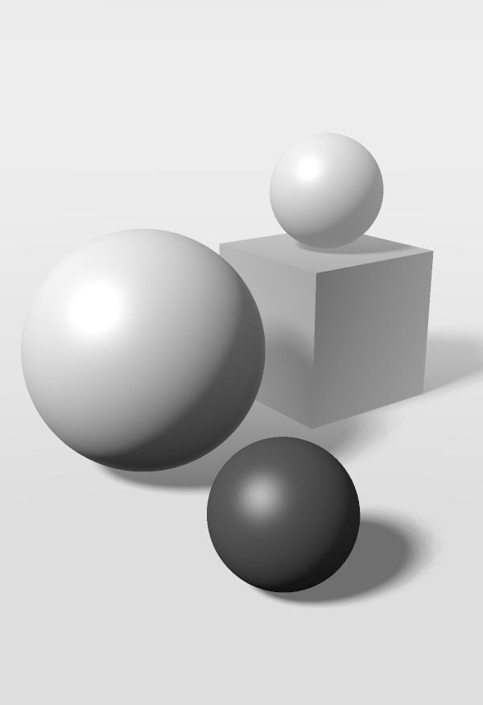
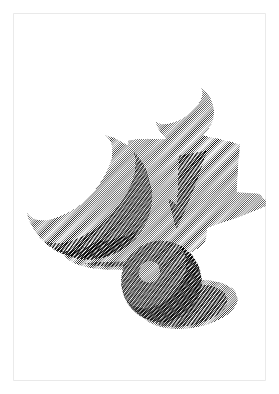
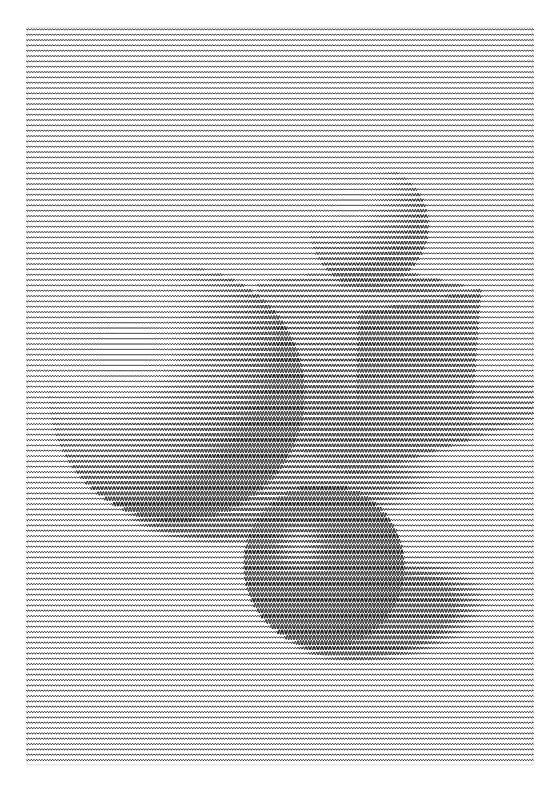
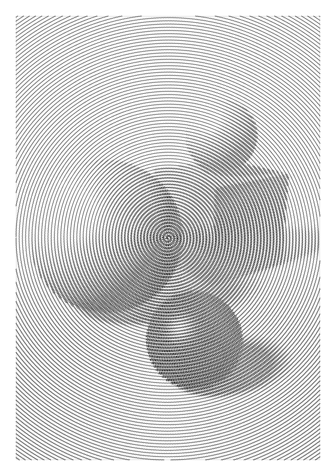
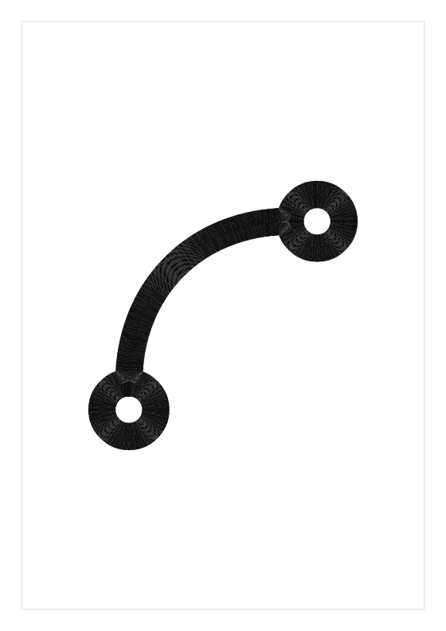

<p align="center">
  <picture>
    <source media="(prefers-color-scheme: dark)" srcset="docs/images/logo-dark.svg">
    
  </picture>
</p>

<p align="center"><strong>Turn images into drawings for pen plotters.</strong></p>

<p align="center">
  <a href="https://github.com/JonathanRJoyner/plotline/actions/workflows/ci.yml"></a>
  <a href="LICENSE"></a>
  
  
</p>

<p align="center">
  <a href="https://jonathanrjoyner.github.io/plotline/"><strong>Open it in your browser</strong></a>
  &nbsp;·&nbsp;
  <a href="#command-line">Command line</a>
  &nbsp;·&nbsp;
  <a href="docs/BRIEF.md">Design brief</a>
</p>

plotline converts raster images into vector line art, such as stippling, single continuous lines, dashes and sketched strokes. It comes with a live preview that shows the algorithm at work, so you can see what a setting does before you commit ink to paper.

<table>
  <tr>
    <td align="center" valign="top" width="33%"><br><sub><b>The image</b></sub></td>
    <td align="center" valign="top" width="33%"><br><sub><b>grid</b>: dots on a regular grid</sub></td>
    <td align="center" valign="top" width="33%"><br><sub><b>hatch</b>: crossing parallel lines</sub></td>
  </tr>
  <tr>
    <td align="center" valign="top"><br><sub><b>waves</b>: rippling lines, one stroke each</sub></td>
    <td align="center" valign="top"><br><sub><b>spiral</b>: one rippling spiral</sub></td>
    <td align="center" valign="top"><br><sub><b>ink</b>: line art, here the logo</sub></td>
  </tr>
</table>

<p align="center"><sub>plotline drew every picture above with a 0.3 mm pen, from images it renders in code.</sub></p>

## Features

- **Five styles,** from dots on a grid to one continuous spiral. The table below describes each one.
- **Live preview.** The browser GUI shows the drawing being built. It runs the engine inside the page as WebAssembly, so your image is never uploaded.
- **Short pen travel.** Every run orders its paths to keep the pen's travel short, and the line styles lift the pen far less often than `grid`.
- **Plotter-ready output.** An SVG in millimetres holds the drawing in one layer, labelled with the name of its pen. A run can also write the paths as JSON, and a PNG preview that draws each mark at its real pen width. For a pen-fitted 3D printer, the GUI writes one G-code file per pen.
- **Real pens.** A bank of common fineliners, technical pens, gel pens, ballpoints and markers gives each pen its maker's line width, and a list of common inks gives it a colour.
- **Presets.** A small JSON file holds the style, page, pens, settings and machine of a run, so you can keep a look and share it.
- **One engine.** The engine is written in Rust and compiled twice: to a native extension for the Python package, and to WebAssembly for the browser. The Python package and the command line are thin layers over it.

| Style | What it draws |
| --- | --- |
| `grid` | A dot on a regular grid wherever the image is dark enough. |
| `hatch` | Straight parallel lines over the dark areas, in three levels that cross over darker tones. |
| `waves` | Parallel lines that ripple more where the image is darker, one pen stroke per line. |
| `spiral` | One spiral from the centre out that ripples the same way. |
| `ink` | Line art, lettering and inked drawings. It outlines every ink shape and fills it with rings, and draws strokes thinner than the pen once down the middle, so the drawing keeps its own shapes and weights. |

## In the browser

Open **[jonathanrjoyner.github.io/plotline](https://jonathanrjoyner.github.io/plotline/)**. There is nothing to install.

1. Drop or paste a PNG, JPEG or WebP image, or click Sample image.
2. Pick a style, change its settings and click Run to watch it draw.
3. Set up your pens in the Pens dialog. The page remembers your setup between visits.
4. Click Export SVG in the toolbar, ready for a pen plotter's own software.

For G-code, enter your machine in the Settings dialog: the drawable area, pen heights, feeds, and start and end G-code. The export panel then writes one G-code file per pen. The preset carries the machine, so save a preset to keep it. A short tour of the page opens on your first visit, and Tour in the toolbar opens it again.

## Command line

There is no release yet, so work from a clone of this repository. Building the Python extension needs a Rust toolchain: install one with [rustup](https://rustup.rs). With [uv](https://docs.astral.sh/uv/) installed as well, run this in the clone, where `uv sync` builds the extension and installs the package:

```sh
uv sync
uv run plotline --help
```

Then draw an image of your own:

```sh
uv run plotline run grid your-photo.jpg --out drawing.svg --preview preview.png
```

This writes `drawing.svg` and `preview.png`, and prints a one-line summary with the path count and an estimated plot time.

| To | Use |
| --- | --- |
| Set the page and margin, in mm | `--width 210 --height 297 --margin 15` |
| Choose the pen, by ink name or `#rrggbb` colour | `--pen 'Fine:0.3:blue'` |
| Change a setting | `--set points.spacing_mm=3` |
| List a style's settings | `plotline describe grid` |
| Save the run's look as a preset | `--save-preset my-look.json` |
| Start a later run from a preset | `--preset my-look.json` |
| Open the live preview locally | `plotline gui` |

`plotline gui` serves the browser GUI from your machine. Building it needs Node, wasm-pack and the `wasm32-unknown-unknown` Rust target: run `npm run wasm`, `npm ci` and `npm run build` in `web/`.

## With an AI assistant

`plotline mcp` serves plotline to an AI assistant over the Model Context Protocol, on stdio. From a clone, `uv sync` installs the MCP extra; once there is a release, `pip install "plotline[mcp]"` will. Give an MCP client the server as `{"command": "plotline", "args": ["mcp"]}`, where `command` is the `plotline` on the client's PATH or the full path to it (for a clone, the one in its `.venv`). The assistant can load an image, run styles, look at previews, also zoomed in on a part of the page, and export the result.

## Roadmap

plotline is early software. The Voronoi styles and Sketch Lines are planned but not built yet. The goals, architecture, decisions and everything still planned are in the [design brief](docs/BRIEF.md).

## License

[MIT](LICENSE)
