# Style guide

Every style turns the image's tone into pen marks in its own way. This guide shows each one on the same picture, says what it is good for, which settings matter and what turning them does, and how to pick a pen for it. New to plotline? The [first plot guide](guide.md) takes you from a picture to paper.

Each picture is the code-rendered still life from the README, drawn on A4 with a 0.3 mm black pen at the style's defaults. There are two exceptions. `ink` is drawn at a threshold of 0.3, because `ink` is made for line art and the still life is not. `learned` is drawn with the `teed-1` model, because it needs a model file; its picture is the one on that model's card in the GUI, which the `model_cards` example draws, since the models are not in the repository. A setting is named as its stage and key, such as `hatch.spacing_mm`; the GUI shows the same settings under each stage's heading, `plotline describe STYLE` lists them with their ranges, and `plotline run` takes them as `--set stage.key=value`.

- [Settings every style shares](#settings-every-style-shares)
- [Lines](#lines): [`grid`](#grid), [`hatch`](#hatch), [`waves`](#waves), [`spiral`](#spiral), [`truchet`](#truchet), [`ink`](#ink), [`learned`](#learned)
- [The Voronoi point family](#the-voronoi-point-family): [`stipple`](#stipple), [`line`](#line), [`dashes`](#dashes), [`tree`](#tree), [`mesh`](#mesh), [`cells`](#cells), [`scribble`](#scribble)
- [Sketch lines](#sketch-lines): [`sketch`](#sketch)
- [Other placers](#other-placers): [`halftone`](#halftone), [`dither`](#dither), [`circles`](#circles)
- [Tone only](#tone-only): [`contours`](#contours), [`flow`](#flow), [`hilbert`](#hilbert), [`mosaic`](#mosaic)

The GUI's style picker groups the styles under these same headings, and a test keeps the two equal, so a new style gets a section here and a family there.

## Settings every style shares

**Image** (the `tone` stage) turns the picture into the map of ink the style draws from. `resolution` is the map's longer side in pixels; more follows the image more closely and runs slower. `black` and `white` clip the ends of the tone range, or `levels` set to `auto` picks them from the image itself. `gamma` above 1 darkens the midtones: `waves`, `spiral` and `mosaic` start at 1.9, because they ink in proportion to the tone and would draw the midtones too light at 1. `contrast` pushes tones away from mid-grey, `blur_mm` smooths away noise and fine texture, and `invert` swaps light and dark. `focus` is a list of points, `[x, y]` as shares of the image from its top-left corner and set in the GUI by turning on Focus and clicking the preview: the map keeps its detail within `focus_mm` of the nearest point and blurs more the further out it goes, up to `focus_blur_mm` from three radii out, so a style's marks spend their detail near the points. Without points nothing changes. `learned` has a Model stage in its place, which places the image on the page the same way.

**Pen use** (the `split` stage) shares the drawing between the pens: the first pen alone, light to dark in list order, or each pen by its colour. With several pens, every style but `ink` and `learned` spreads its marks so that one pen does not draw on top of another. By colour, the tone `gamma` darkens each pen's own share of a colour rather than adding grey, which the black pen would draw over every colour ([decision](decisions/2026-10-17-colour-lanes.md)). `waves`, `spiral` and `hilbert` lift a pen where its share of the ink is under half of what their lines cover over white, so a pen leaves paper and other pens' colours alone.

**Path order** (the `order` stage) joins the paths that meet into the fewest pen-down trails (`join`: `on` draws each edge once, `retrace` also draws some short edges twice so the pen lifts less; see [the decision](decisions/2026-10-17-join-paths-into-trails.md)), reorders the paths to cut pen-up travel (`optimize`), drops paths shorter than `min_length_mm`, which clears specks, and, with `simplify_mm` above 0, removes the vertices a pen cannot show (Ramer–Douglas–Peucker; see [the decision](decisions/2026-10-16-path-simplification.md)).

**Density.** Every style but `ink` and `learned` has one density setting, named in its section. Fit to target in the GUI, the `--fit-minutes`, `--fit-paths`, `--fit-metres` and `--fit-dots` flags and the MCP `fit` tool change that setting until the drawing meets a plot time, a path count, metres of line or a dot count.

**Looks.** Most styles offer a few starting points besides their defaults (Balanced), each chosen by measuring the still life, a landscape and a gradient on A4 with a 0.3 mm pen: Faithful follows the image's tones most closely, Quick plots in about half an hour, and Fine draws the densest marks that still plot cleanly. A look sets only its few settings, so Pen use and the image settings stay. Pick one with Look under the style in the GUI, `--look` on the command line or `look` on the MCP `run` tool; [the looks decision](decisions/2026-10-16-looks.md) has the rules and every measurement.

**Pen lifts.** Each path costs one lift of the pen. On a plotter that lifts slowly, or on a pen-fitted 3D printer where every lift is a Z move, styles that draw a few long paths (`waves`, `spiral`, `line`, `scribble`, `hilbert`, `contours`, `flow`) plot faster and wear the machine less than styles of thousands of dots or strokes.

## Lines

### `grid`

A dot at every point of a square grid where the ink reaches a threshold. Tone shows only as dots or no dots, so the result reads like a poster with one level.

**Use it for** bold, graphic pictures with clear shapes, and as a quick first plot to check the page and the pen.

**Settings**
- `points.spacing_mm` (density): the grid pitch. Finer spacing gives more detail and more dots.
- `points.threshold`: the least ink that gets a dot. Lower it to bring in the midtones.

**Pens.** A dot is one touch of the pen, so the pen's width is the dot's size. A wide marker gives a strong pattern; a fine liner needs a fine spacing to show anything. Every dot is a pen lift.

**Looks:** Quick (`points.spacing_mm` 1.8: about 30 minutes on the median test image, against 92) and Fine (0.8 mm).

### `hatch`

Straight parallel lines over the areas dark enough, the engraver's technique. Each further level adds lines at another angle over darker tones, which is cross-hatching.

**Use it for** a classic pen-and-ink look, architecture and objects with flat areas of tone.

**Settings**
- `hatch.spacing_mm` (density): the distance between lines.
- `hatch.levels`: how many crossing layers, 1 to 4. Each turns by 180 / levels degrees and covers only darker ink.
- `hatch.threshold`: the least ink that gets lines. The levels spread evenly between it and full ink.
- `hatch.angle_deg`: the direction of the first layer.

**Pens.** Fineliners from 0.1 to 0.3 mm. Where layers cross the pen passes a spot twice, which most papers take well. Keep the spacing above the pen width, or the lines merge into a smear.

**Looks:** Fine (`hatch.spacing_mm` 0.7). Its best tone error comes within 10 % of the default's, so it has no Faithful.

### `waves`

Parallel lines that ripple more where the image is darker, each line one stroke. The ripples carry the tone, so the lines never stop.

**Use it for** a calm, even texture with very few pen lifts; portraits and soft gradients read well.

**Settings**
- `waves.spacing_mm` (density): the distance between lines.
- `waves.amplitude`: how far a ripple swings over full ink, as a share of half the spacing. Lower is quieter and lighter.
- `waves.wavelength_mm`: the length of one ripple. Shorter ripples look darker and take longer to draw.
- `waves.angle_deg`: the direction of the lines.

**Pens.** Any pen that draws a steady line, ballpoints and gel pens included, since each line is one long stroke. A fine pen keeps the ripples apart.

**Looks:** Faithful (`waves.spacing_mm` 2.8: half the default's tone error in the same plot time) and Fine (1.0 mm).

### `spiral`

One spiral from the centre out, rippling more where the image is darker. It is `waves` wound around the middle of the page.

**Use it for** round subjects and a single-stroke look that draws the eye to the centre.

**Settings**
- `spiral.spacing_mm` (density): the distance between turns.
- `spiral.amplitude` and `spiral.wavelength_mm`: as for `waves`.

**Pens.** As for `waves`. The spiral is one long stroke, broken only where it leaves the image.

**Looks:** Fine (`spiral.spacing_mm` 1.4).

### `truchet`

Square tiles in random turns, each holding quarter-circle arcs about two opposite corners, so the arcs join from tile to tile into winding curves (Smith's Truchet tiles). Darker tiles nest more arcs, and the counts are spread by error diffusion so the tone stays even.

**Use it for** a decorative, pattern-first look; the picture shows through the pattern rather than in detail.

**Settings**
- `truchet.spacing_mm` (density): the distance between nested arcs. Closer arcs fit more into a tile and draw darker.
- `truchet.tile_mm`: the tile size. Smaller tiles show more of the picture; larger ones show more of the pattern.
- `truchet.seed`: picks another arrangement of turns. A change of tone never reshuffles them.

**Pens.** Keep `spacing_mm` above the pen width, or the nested arcs merge into bands; plot lint warns about it.

**Looks:** Faithful (`truchet.spacing_mm` 0.3, the default pen's width, so the arcs fill into bands).

### `ink`

Draws the marks of line art, lettering and inked drawings as they are. Every ink shape is outlined and filled with rings, and strokes thinner than the pen get one line down the middle, so the drawing keeps its own shapes and weights. It starts from a finer tone map than the other styles (`tone.resolution` 2500) to keep hairlines.

**Use it for** scans of drawings, logos, lettering and comics. On a photograph it draws the dark areas as solid shapes, as in the picture.

**Settings**
- `ink.threshold`: the ink that counts as part of a shape. Lower it to keep faint lines; raise it to drop a grey background.
- `ink.mode`: `fill` outlines and fills each shape; `outline` draws the outline only; `centreline` draws one line down each stroke, for line art drawn in single strokes.
- `ink.spacing`: the gap between fill rings as a share of the pen width. Below 1 the rings overlap, so filled shapes plot solid.
- `ink.min_area_mm2`: drops shapes smaller than this, such as dust in a scan.

**Pens.** Set the pen you will plot with before running: the rings are spaced by its width. Large solid areas lay down a lot of ink, so use paper that takes it.

**Looks:** Balanced only: it has no density setting.

### `learned`

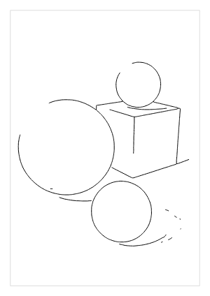

Draws the lines that a trained model finds in the image. The model, a small neural network, turns the picture into a map of where its lines are; the ink stage then draws each line once down its middle, as `ink` does in its centreline mode, so a line is one pen stroke.

**Use it for** a drawing that follows the edges and outlines of a photograph instead of its tones. Which lines you get depends on the model: `teed-1`, the one plotline lists today, finds edges, texture included, rather than an artist's selection of lines.

**Getting a model.** `learned` draws nothing until you have a model, and the models are not part of plotline. In the browser, Styles, then Get models, lists the models plotline offers, each card with its picture, size and licence; Download first shows the licence, the attribution, what the model was trained on, its source and its paper, and fetches nothing until you accept. Each model you have then appears in the Styles tab as an entry of its own. On the command line, `plotline models list` shows them and `plotline models get teed-1` shows the same and downloads it. The browser fetches the model runtime, a second WebAssembly module, when a model is first downloaded, loaded or restored, so a visit that never uses one does not download it. A model file of your own, an ONNX file of up to 200 MB, loads from Load your own in the browser or with `plotline models add`; you are responsible for its licence.

**Settings**
- `model.model`: the id of the model to draw with, such as `teed-1`. It is empty until you choose one, and a run without one says how to get a model.
- `model.resolution`: the long side, in pixels, of the image the model sees, from 256 to 2048. More finds finer lines and takes longer. The model works on tiles of 512 pixels, so memory stays low at any resolution.
- `model.invert`: swaps line and paper in the model's answer. Only a model file of your own that draws white lines on black needs it; the listed models already run the right way.
- `ink.threshold`: how dark a line must be to be drawn. Lower it to keep faint lines; raise it to keep only the strong ones.

The model's answer is cached like any stage's, so changing the threshold, the pens or the path order does not run the model again. A few pixels of the model's answer can differ between the browser and the command line, so the two may not draw exactly the same paths.

**Pens.** Any pen; a line is drawn at the pen's own width. Each line costs one pen lift, and a busy photograph gives many short ones, so raise `ink.threshold`, or `order.min_length_mm`, to drop the fainter and shorter ones.

**Looks:** Balanced only: it has no density setting.

## The Voronoi point family

These styles share one placement of points: the points spread evenly while staying dense where the image is dark (weighted Voronoi relaxation). The relaxation is the slow part, so switching between these styles reuses the points and redraws at once. Their placement settings are the same everywhere:

- `voronoi.count` (the density for every style in the family): the number of points. More points give finer detail and a longer plot. It counts per pen: by colour the pens share their points by ink, so a pen whose colour makes up a tenth of the picture's ink places about a tenth of them, and light to dark each pen places its own.
- `voronoi.exponent`: density follows ink to this power. 2 suits `line`, `tree`, `mesh` and `cells`, which put more ink between close points; the default of 1 keeps the points shared with `stipple`.
- `voronoi.iterations`: relaxation passes. More spread the points more evenly.
- `voronoi.seed`: picks another starting scatter.

### `stipple`

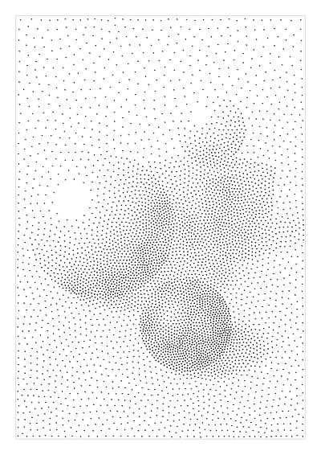

A dot at each point, sized by the ink under it.

**Use it for** the classic stippled engraving look, and subjects with soft shading.

**Settings**
- `stipple.size_mm`: the dot diameter over full ink.
- `stipple.vary`: how much lighter ink shrinks a dot; 0 keeps every dot the same size.
- `stipple.shape`: `auto` draws a dot no wider than the pen as one touch and a larger one as a filled spiral; `point`, `circle` and `spiral` force one shape.

**Pens.** Every dot is a pen lift. A fine pen with `point` dots plots fastest; spiral-filled dots go over the same spot many times, so use a pen that does not flood the paper.

**Looks:** Fine (`voronoi.count` 12,000).

### `line`

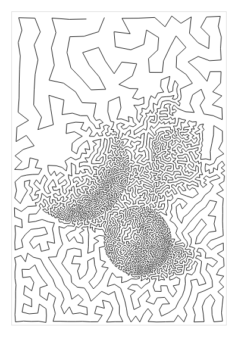

The points joined into one unbroken line that does not cross itself, a travelling-salesman tour.

**Use it for** single-line portraits, and machines where pen lifts are slow or wear the hardware.

**Settings**
- `tsp.optimize`: shortens the line and removes its crossings; off leaves the quicker, rougher nearest-neighbour line.
- `tsp.closed`: ends the line where it started.
- `voronoi.exponent`: try 2, which puts the line's ink where the image is dark.

**Pens.** Any pen that draws a steady line. With one stroke, the pen never lifts.

**Looks:** Faithful (`tone.response` auto and `voronoi.count` 20,000: the tone error falls from 0.149 to 0.056).

### `dashes`

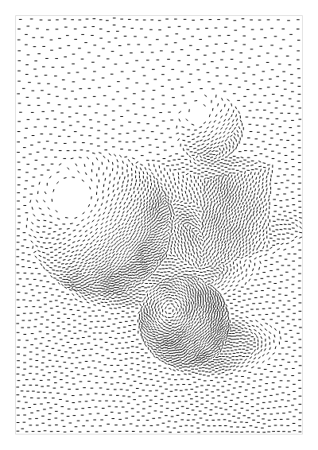

A short stroke at each point, laid along the image's edges, like quick pen strokes that follow form.

**Use it for** a lively, hand-drawn texture on subjects with clear edges.

**Settings**
- `dashes.length_mm`: the length of each dash.
- `dashes.follow_edges`: lays the dashes along the edges; off lays every dash at one angle.
- `dashes.angle_deg`: the turn from the edge direction, or the fixed angle when edges are not followed.

**Pens.** Every dash is a pen lift. Fine and medium fineliners work well.

**Looks:** Faithful (`voronoi.count` 12,000).

### `tree`

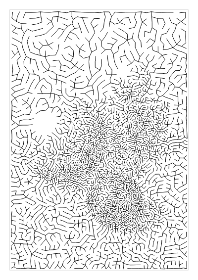

The points joined by the shortest tree, so every point is reached and no loop forms. It looks like branching veins or roots.

**Use it for** organic, branching textures.

**Settings.** The tree has none of its own; try `voronoi.exponent` 2.

**Pens.** Fine pens. The tree is drawn as long branching strokes, and `order.join` is `retrace`, which draws some short twigs twice to join the strokes, so the pen lifts far less often than there are points.

**Looks:** Faithful (`tone.response` auto and `voronoi.count` 20,000).

### `mesh`

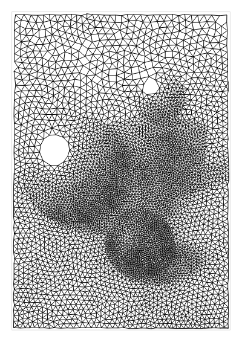

A triangle mesh over the points (their Delaunay triangulation), dense and dark where the points crowd.

**Use it for** a low-poly, technical look.

**Settings**
- `delaunay.max_edge_mm`: leaves out edges longer than this, such as those across light areas, so white stays white.

**Pens.** A fine pen: the mesh draws a lot of line, and close edges merge under a wide pen. `order.join` is `retrace`, so the mesh is drawn in long strokes that draw some short edges twice.

**Looks:** Faithful (`tone.response` auto and `voronoi.count` 6,000) and Fine (`voronoi.count` 20,000).

### `cells`

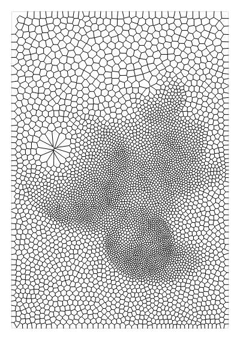

The outlines of the points' Voronoi cells: small cells where it is dark, large ones where it is light, like a crackle glaze or a dried riverbed.

**Use it for** a cellular, organic texture.

**Settings.** The cells have none of their own; try `voronoi.exponent` 2.

**Pens.** A fine pen. Every corner of a cell joins three edges, so the outlines cannot be drawn in fewer pieces than half the corners; `order.join` is `retrace`, which draws some short edges twice to join the pieces and lifts the pen about a seventh as often. Set it to `on` to draw every edge once, with many more lifts.

**Looks:** Faithful (`tone.response` auto and `voronoi.count` 8,400) and Fine (`voronoi.count` 12,000).

### `scribble`

Loops traced along the same line `line` draws through the points: small and close where the image is dark, wide and loose where it is light, like circular scribble art.

**Use it for** an energetic single-stroke look, and when you want `line`'s single stroke with more darkness in the shadows.

**Settings**
- `scribble.spacing_mm`: how far the loops move along the line in one turn over full ink. Closer loops draw darker.
- `scribble.white_spacing_mm`: the same over white.
- `scribble.radius_mm` and `scribble.white_radius_mm`: the loop size over full ink and over white.
- `scribble.flatten` and `scribble.tilt_deg`: flatten the loops into ellipses and turn their long axis, like a tilted pen.

**Pens.** Loops cross each other all the time, so use a pen that does not bleed or pill the paper where it passes again. The whole drawing is one stroke.

**Looks:** Faithful (`voronoi.count` 20,000).

## Sketch lines

### `sketch`

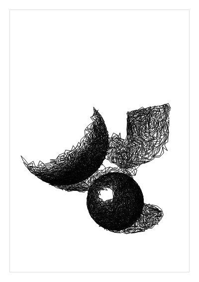

Straight strokes chained from dark to dark. From the pen it tries many directions, draws the darkest, lightens the map under the stroke, and carries on, so the strokes pile up where the image is darkest, like a quick pencil sketch.

**Use it for** a loose, gestural look.

**Settings**
- `sketch.max_lines` (density): the most segments to draw.
- `sketch.length_mm`: the length of each segment. Longer gives a looser drawing.
- `sketch.lighten`: the ink removed under each segment. Less gives more, denser strokes.
- `sketch.stop`: the ink left below which no stroke is drawn. Higher ends the drawing sooner and breaks it into more strokes.
- `sketch.candidates`: the directions tried for each segment. More find darker paths and run slower.
- `sketch.seed`: picks other directions.

**Pens.** Fine pens give the pencil look. Strokes cross and retrace dark areas, so a wet pen can soak the paper there.

**Looks:** Faithful (`tone.response` auto and `sketch.max_lines` 20,000) and Fine (`sketch.max_lines` 10,000).

## Other placers

### `halftone`

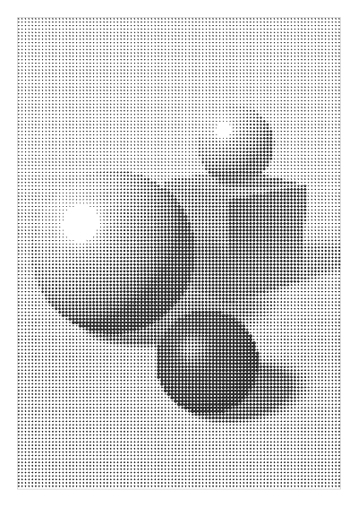

Dots on a regular grid, each sized by the ink, like a printed halftone screen.

**Use it for** a print, newspaper or pop-art look.

**Settings**
- `points.spacing_mm` (density): the screen pitch.
- `stipple.size_mm`: the dot diameter over full ink.
- `stipple.vary`: how much lighter ink shrinks a dot.
- `stipple.shape`: as for `stipple`.
- `points.threshold`: the least ink that gets a dot.

**Pens.** Large dots are filled with spirals, so a wider pen fills them in fewer turns and plots faster. Every dot is a pen lift; this is one of the slowest styles to plot.

**Looks:** Balanced only: with the 0.3 mm pen it leaves specks on light gradients at its default spacing and every finer one.

### `dither`

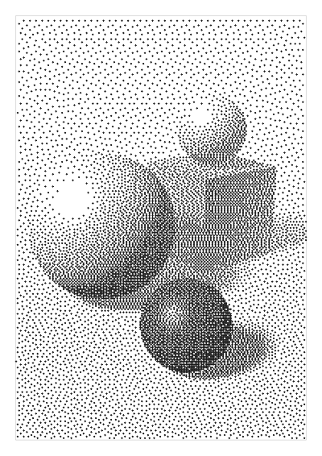

Dots where error diffusion puts them: each grid cell gets a dot or none, and the rounding error is passed on to the neighbours, so the dots' density follows the tone.

**Use it for** a crisp, digital texture with true midtones.

**Settings**
- `dither.spacing_mm` (density): the grid cell; at most one dot per cell.
- `dither.serpentine`: scans alternate rows in opposite directions, which breaks up diagonal patterns.

**Pens.** A dot is one touch of the pen, so the pen's width is the dot's size; match it to the spacing. Every dot is a pen lift.

**Looks:** Faithful (`dither.spacing_mm` 0.8) and Quick (1.8 mm: about 30 minutes on the median test image, against 93).

### `circles`

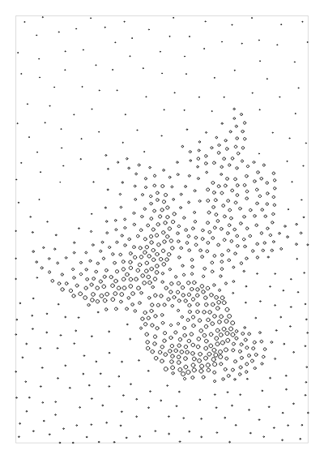

Circles packed without overlapping, larger and closer where it is darker.

**Use it for** a bubbly, graphic texture.

**Settings**
- `poisson.spacing_mm` (density): the distance between circle centres over full ink. Lighter areas space them further apart.
- `stipple.size_mm`: the circle diameter over full ink.
- `stipple.vary`: how much lighter ink shrinks a circle.
- `stipple.shape`: `circle` by default; `spiral` fills them.
- `poisson.seed`: picks another packing.

**Pens.** Any pen; the circles are hollow, so they take little ink.

**Looks:** Faithful (`poisson.spacing_mm` 1.5).

## Tone only

These styles draw from the tone map alone, with no points.

### `contours`

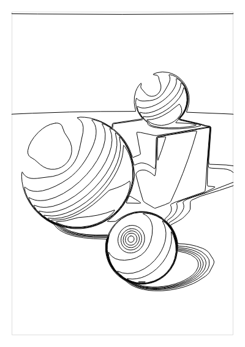

Level lines of the image, like a topographic map: each line follows one tone.

**Use it for** a cartographic look, and subjects with smooth shading such as faces.

**Settings**
- `contours.levels` (density): the number of levels between white and full ink.
- `contours.smooth_mm`: blurs the map before tracing. More gives rounder, calmer lines.

**Pens.** Any pen. The lines are long, so the pen lifts rarely.

**Looks:** Balanced only: its default levels already stack where the tone is steep.

### `flow`

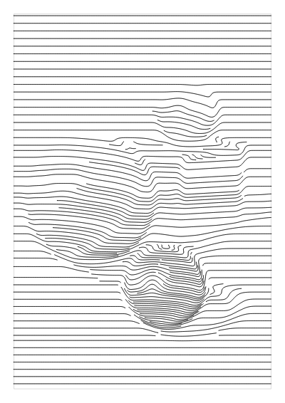

Evenly spaced lines that follow the image's edges, closer together where it is darker.

**Use it for** a combed, wood-grain or brushed look that follows form.

**Settings**
- `flow.min_spacing_mm` (density): the line spacing over full ink.
- `flow.max_spacing_mm`: the line spacing over white.
- `flow.smooth_mm`: blurs the map before the edge directions are measured. More gives longer, smoother lines.
- `flow.angle_deg`: the direction lines take where the image is flat.

**Pens.** Any pen; the lines are long.

**Looks:** Faithful (`tone.response` auto and `flow.min_spacing_mm` 0.3).

### `hilbert`

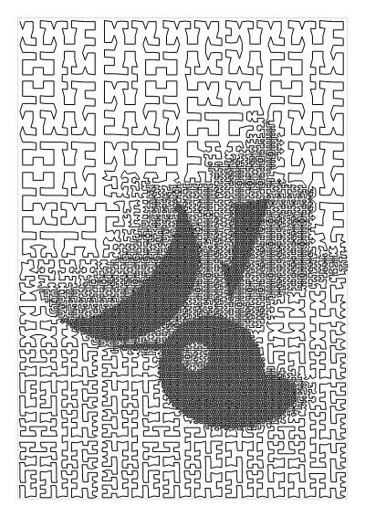

One space-filling curve over the whole page that folds tighter where it is darker. With one pen it is a single unbroken line.

**Use it for** a maze-like, digital texture, and single-stroke plots.

**Settings**
- `hilbert.cell_mm` (density): the smallest fold, used over full ink.
- `hilbert.max_cell_mm`: the largest fold, used over white.

**Pens.** Keep `cell_mm` above the pen width so the finest folds stay open.

**Looks:** Faithful (`tone.response` auto and `hilbert.cell_mm` 0.3).

### `mosaic`

The image cut into patches that follow its shapes (SLIC superpixels), each filled with parallel lines along its own long axis, closer together where it is darker. Dark patches zig-zag in one stroke; light ones stay loose strokes.

**Use it for** a painterly, patchwork hatching where the strokes follow the shapes.

**Settings**
- `mosaic.spacing_mm` (density): the line spacing over full ink. Lighter patches space theirs wider.
- `mosaic.region_mm`: about how wide one patch is.
- `mosaic.compactness`: higher keeps the patches round; lower lets them follow the image's shapes.

**Pens.** Fineliners. Keep `spacing_mm` above the pen width.

**Looks:** Faithful (`mosaic.spacing_mm` 0.3: the tone error falls from 0.044 to 0.017).
